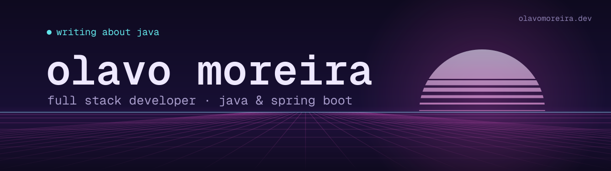
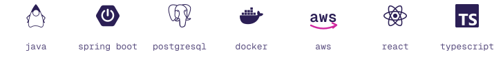

  

 

  

  <a href="https://olavomoreira.dev/">olavomoreira.dev</a> ·
  <a href="https://olavomoreira.dev/blog">blog</a> ·
  <a href="https://www.linkedin.com/in/olavospmoreira/">linkedin</a>

### `> about`

Full Stack Developer at Petize, building and maintaining Java & Spring Boot systems for finance, vacation-rental management and e-signature. REST APIs, external integrations, relational data and automated tests, with React and TypeScript when the product needs it.

### `> stack`

<picture>
  <source media="(prefers-color-scheme: dark)" srcset="./assets/stack-dark.svg" />
  <source media="(prefers-color-scheme: light)" srcset="./assets/stack-light.svg" />
  
</picture>

also: Spring Security · Spring Batch · WebFlux · MySQL · MongoDB · JUnit · Mockito · CI/CD · Railway

### `> projects`

**[Plataforma de Compras Públicas](https://olavomoreira.dev/projects/001-compras-publicas/plataforma-compras-publicas)** · [live ↗](https://stag-front-stag.up.railway.app/) 
Modular SaaS for the public sector: price quotes, contract search, inventory, expiry alerts, WhatsApp notifications and auto-generated documents. 
`saas` `procurement` `contracts` `inventory` `whatsapp`

**[Clube do Bolinha](https://olavomoreira.dev/projects/002-bolinha-club/clube-do-bolinha)** · [live ↗](https://bolinha-club.squareweb.app/sorteios) 
SaaS for League of Legends players: live games, match-history sync and team draws (ARAM, Arena, Valorant customs) with KDA and a Discord ranking. 
`saas` `league-of-legends` `valorant` `discord`

### `> writing`

Java studies for beginners, in Portuguese, at [olavomoreira.dev/blog](https://olavomoreira.dev/blog).

<!-- BLOG-POST-LIST:START -->
- [Trabalhando com Exceptions - Java](https://olavomoreira.dev/blog/005-trabalhando-com-exceptions)
- [Trabalhando com Strings - Java](https://olavomoreira.dev/blog/004-trabalhando-com-strings)
- [Trabalhando com Objetos - Java](https://olavomoreira.dev/blog/002-trabalhando-com-objetos)
<!-- BLOG-POST-LIST:END -->

### `> activity`

<picture>
  <source media="(prefers-color-scheme: dark)" srcset="https://raw.githubusercontent.com/olavomoreirap/olavomoreirap/output/snake-dark.svg" />
  <source media="(prefers-color-scheme: light)" srcset="https://raw.githubusercontent.com/olavomoreirap/olavomoreirap/output/snake-light.svg" />
  
</picture>

### `> contact`

Questions about a study, found a mistake, or want to talk Java? [LinkedIn](https://www.linkedin.com/in/olavospmoreira/) · [olavomoreira.dev](https://olavomoreira.dev/#contato)
